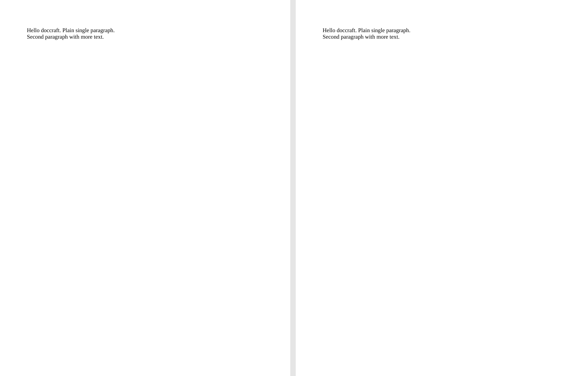
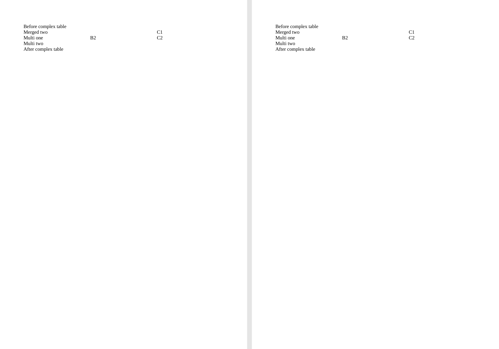
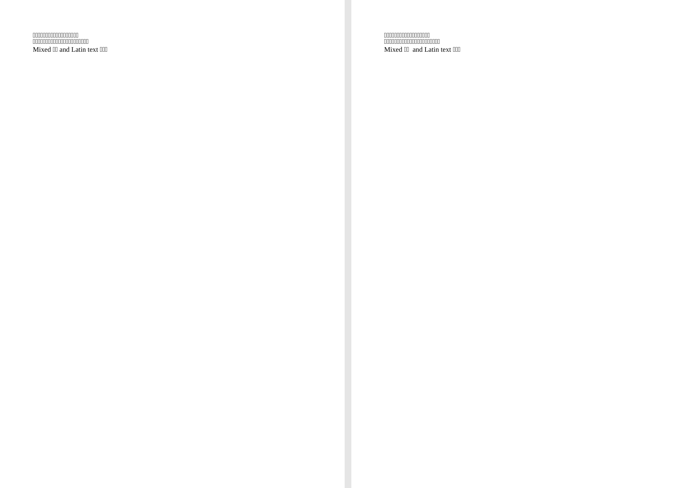
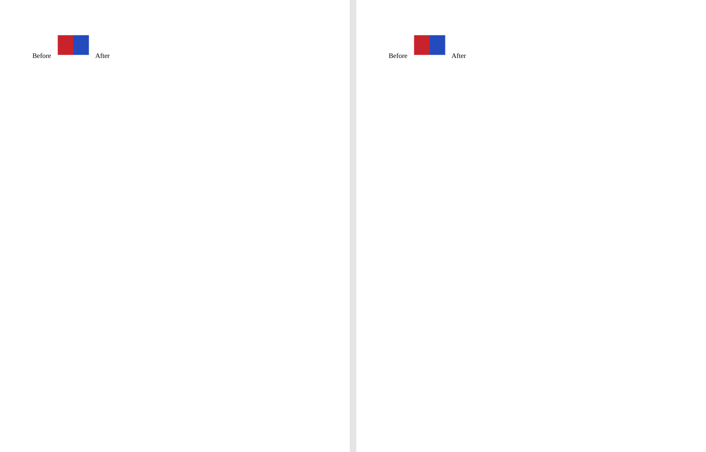
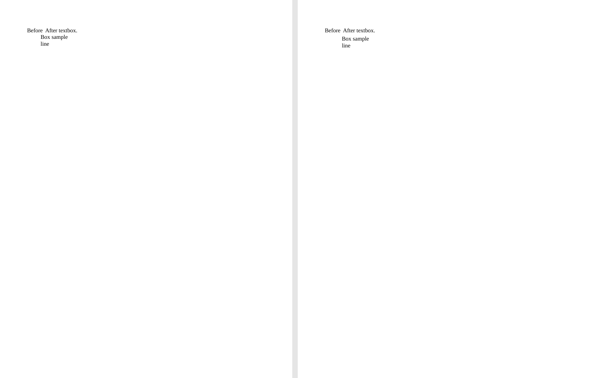
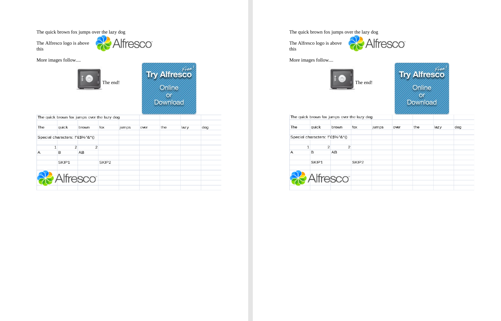
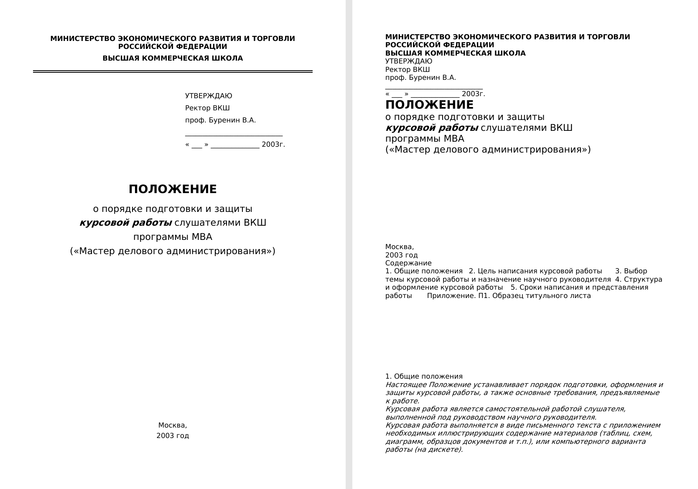

# doccraft

A fast, dependency-free `.doc` → `.docx` converter with a clean-room
[MS-CFB]/[MS-DOC] parser.

doccraft reads Word 97–2003 binary documents and writes ECMA-376 Transitional
DOCX, locally, without an Office installation. The conversion core is C++23 and
ships as one 1.3 MiB binary (1,394,400 bytes, x86-64 Linux Release) with no
third-party runtime dependencies. A 5 MiB structured document converts in
0.29 s and a 100 MiB one in 6.4 s on the regression host (3.9 s on the
reference host). The release is at **v0.9.0-rc1 preparation**: the main feature
paths are implemented, while M6 hardening and M7 release tasks remain open.

## Why doccraft

The comparison below uses one input: a 4.75 MiB (4,975,616-byte) structured DOC
containing headings, tables, footnotes, headers and footers. Each tool was run
three times on the same idle Linux host; the table reports the median wall time
and the largest peak RSS from `/usr/bin/time`. Time includes process startup.
The numbers are measurements, not projections.

| | doccraft | LibreOffice 24.2.7.2 | antiword 0.37 | wvWare 1.2.9 (`wvText`) |
|---|---|---:|---:|---:|
| Output | DOCX | DOCX | plain text | plain text |
| Median wall time | **0.29 s** | 5.54 s | 0.14 s | 0.54 s |
| Peak RSS | **51 MiB** | 216 MiB | 2.6 MiB | 11 MiB |
| Installed footprint | 1.3 MiB binary | 256 MiB tree | 0.6 MiB package | 0.7 MiB package |
| Runs offline | yes | yes | yes | yes |

`antiword` and `wvWare` emit text only, so their timings are not a like-for-like
format comparison; they are included because they are the usual command-line
alternatives. Online conversion services are not benchmarked here: they require
uploading the document to a third party, which is a different privacy and
deployment model rather than a different runtime. LibreOffice and the two text
tools were installed only for this measurement; doccraft does not depend on
them.

The design choice behind the numbers is a four-layer pipeline (container →
binary parser → format-neutral IR → OOXML writer) with the IR as the only hub.
Each layer is testable on its own, and no layer knows the concepts of the next.

## Quick start

Requires CMake 3.20+, a C++23 compiler, and network access for the first
configure to fetch GoogleTest. The conversion binary itself needs no Office
installation and no third-party library at runtime.

```bash
cmake -B build -DCMAKE_BUILD_TYPE=Release
cmake --build build -j
ctest --test-dir build --output-on-failure

build/src/cli/doccraft convert input.doc -o output.docx
build/src/cli/doccraft convert protected.doc --password secret -o output.docx
build/src/cli/doccraft inspect input.doc
```

## What it handles

- Text and formatting: ANSI and UTF-16 pieces; character, paragraph, and
  section properties; styles, numbering, headers, footers, and multiple
  sections.
- Structure: tables (including nested tables), hyperlinks and general fields,
  bookmarks, comments, footnotes, and endnotes.
- Embedded content: inline and floating images, main-story floating text
  boxes, and OLE ObjectPool payloads with field-result previews.
- Languages: Unicode text, RTL and complex-script formatting, and document
  language ID to ANSI code-page mapping. The implementation lists 14 Windows
  code pages; non-CP1252 decoding needs iconv at build time.
- Recovery: final piece-table reconstruction for fast-saved documents, legacy
  RC4 and RC4 CryptoAPI decryption with a password, and warnings for selected
  recoverable formatting or header damage.

Feature states and their boundaries are in [the design checklist](docs/DESIGN.md)
and [known simplifications](docs/KNOWN-SIMPLIFICATIONS.md). The applicable sprm
ledger is tracked in [SPRM coverage](docs/SPRM-COVERAGE.md).

## Platform support

The conversion core (`src/base`, `src/cfb`, `src/doc`, `src/model`, `src/docx`)
is standard C++23 plus vendored miniz and pugixml, and calls no operating
system service. Only two places are platform-specific: `src/cli` (files and
stdio) and the ANSI code-page decoder in `src/base/charset.cc`. Targets without
a command line use the C API in [`src/api/doccraft_api.h`](src/api/doccraft_api.h):
one `.doc` buffer in, one `.docx` buffer out (`doccraft_convert_buffer`).

| Target | Artifact | ANSI code pages | Verified |
|---|---|---|---|
| Linux | CLI + libraries | iconv (glibc) | built and tested in CI |
| macOS | CLI + libraries | iconv (libSystem) | built and tested in CI |
| Windows | CLI + libraries | `MultiByteToWideChar` | built and tested in CI (MSVC, warnings-as-errors off) |
| Android (NDK) | libraries + C API | iconv (bionic), else CP1252 only | CMake options in place, toolchain not run here |
| iOS | libraries + C API | iconv (libSystem), else CP1252 only | CMake options in place, toolchain not run here |
| WebAssembly | libraries + C API | CP1252 only | library-only build verified on Linux, emsdk not run here |

Build the library and C API only (the shape the embedded targets use):

```bash
cmake -B build-lib -DCMAKE_BUILD_TYPE=Release \
      -DDOCCRAFT_BUILD_CLI=OFF -DDOCCRAFT_BUILD_TESTS=OFF
cmake --build build-lib -j
```

WebAssembly, Android and iOS cross builds use the same two options with the
toolchain on the command line:

```bash
# WebAssembly (needs emsdk on PATH)
emcmake cmake -B build-wasm -DDOCCRAFT_BUILD_CLI=OFF -DDOCCRAFT_BUILD_TESTS=OFF
cmake --build build-wasm -j

# Android (the NDK ships its own toolchain file)
cmake -B build-android -DCMAKE_TOOLCHAIN_FILE=$ANDROID_NDK/build/cmake/android.toolchain.cmake \
      -DANDROID_ABI=arm64-v8a -DANDROID_PLATFORM=android-21 \
      -DDOCCRAFT_BUILD_CLI=OFF -DDOCCRAFT_BUILD_TESTS=OFF
cmake --build build-android -j

# iOS (community toolchain, e.g. ios-cmake 4.x)
cmake -B build-ios -G Xcode \
      -DCMAKE_TOOLCHAIN_FILE=ios.toolchain.cmake -DPLATFORM=OS64 \
      -DDOCCRAFT_BUILD_CLI=OFF -DDOCCRAFT_BUILD_TESTS=OFF
cmake --build build-ios --config Release
```

Boundaries that matter on those targets:

- **WebAssembly has no file system**, so no CLI is built there; the C API is the
  only entry point. With neither iconv nor `MultiByteToWideChar`, only CP1252
  decodes correctly - `doccraft_supports_codepage()` reports false for the other
  ANSI pages and the converter degrades their text to a CP1252 approximation.
- **Windows**: `permissions()` there only carries the read-only attribute, so
  input validation also probes with an open; diagnostics are written in binary
  mode so they stay byte-identical to the POSIX builds. The CLI takes narrow
  (ANSI code page) paths because that is what `argv` holds - pass UTF-8 paths on
  Windows through the C API instead.
- **iOS and Android** ship no command line either. Only the library and C API
  boundary is provided; a JNI wrapper and a Swift package are separate work.
- **CP1255 (Hebrew) and CP1258 (Vietnamese)** decode one character behind on
  glibc, because its tables are stateful and the decoder is per-character; see
  [known simplifications](docs/KNOWN-SIMPLIFICATIONS.md).

## Quality engineering

Every claim below is enforced by a committed test or recorded measurement, not
by a checklist review.

| Gate | What it covers |
|---|---|
| **585 ctest entries** | Unit and end-to-end tests across all four layers, plus Python checks for ZIP structure, text consistency, API/CLI parity and degraded-input diagnostics. |
| **680 real documents** | Apache POI, LibreOffice `sw/qa`, wvWare, Aspose and GOVDOCS1, de-duplicated by MD5. At the recorded run: 596 clean conversions + 29 with warnings = 625 (91.9%), 55 correctly rejected as damaged or encrypted, **0 crashes**. |
| **Golden gate** | The release audit converts 40 committed non-encrypted samples (12 corpus + 28 fixtures) twice; every ZIP part is SHA-256 hashed. Both runs must agree, and the aggregate manifest is compared with the pre-change snapshot. This is what made the audit's non-semantic edits safe to land. |
| **ASan** | A CI job runs the full suite under AddressSanitizer with `ASAN_OPTIONS=detect_leaks=0`. The deterministic mutation suite in `tests/fuzz_test.cc` also runs there. |
| **Pixel comparison** | LibreOffice renders the source DOC and the converted DOCX independently; corresponding pages are compared at 150 DPI with a 0.1% bad-pixel threshold. 37 samples are recorded: 32 PASS, 4 FAIL, 1 RENDER_ERROR. |
| **Format and lint** | `clang-format` runs as a `format-check` target; `-Wall -Wextra -Wpedantic -Werror` is on for GCC and Clang. |

The external corpus is not committed (size and licensing). See
[docs/CI.md](docs/CI.md) for the optional corpus job and how to point it at a
local or self-hosted copy. The committed measurements live in
[`tests/perf/baseline.json`](tests/perf/baseline.json) and
[`docs/perf-baseline.md`](docs/perf-baseline.md).

## Measured performance

The table below is the committed regression baseline. It converts generated
structured DOC files five times per size; wall time is the median and peak RSS
is the maximum of those runs. These are measurements from that baseline, not
cross-machine guarantees.

| Input DOC | Actual size | Median wall time | Peak RSS |
|---:|---:|---:|---:|
| 1 MiB tier | 1.00 MiB | 0.060 s | 14.0 MiB |
| 5 MiB tier | 5.00 MiB | 0.288 s | 54.0 MiB |
| 20 MiB tier | 20.00 MiB | 1.176 s | 203.7 MiB |
| 50 MiB tier | 50.24 MiB | 1.263 s | 233.7 MiB |
| 100 MiB tier | 99.99 MiB | 6.367 s | 996.2 MiB |

The 100 MiB tier is 3.913 s on the faster reference host recorded in
[`docs/perf-baseline.md`](docs/perf-baseline.md); the regression host used for
`tests/perf/baseline.json` is about 1.6× slower at every size. Memory is not yet
bounded: the 100 MiB result still keeps the decoded text buffer in RAM, and
streaming plus an explicit memory cap are M6 work.

Reproduce with `tests/perf/gen_corpus.py` and `tests/perf/run_perf.py` after
building the converter.

## Visual fidelity

The [pixel comparison pipeline](tests/pixelcompare/README.md) renders the same
source `.doc` through two LibreOffice paths: source DOC → PDF → PNG, and source
DOC → doccraft DOCX → PDF → PNG. It compares corresponding pages at 150 DPI,
rejecting a page with a size mismatch or at least 0.1% pixels differing by more
than 16 grayscale levels. Page-count exceptions require a sample-specific
`.allow` file.

At the recorded baseline, 32 of 37 measured samples pass, four fail, and one
cannot be rendered from the output DOCX by LibreOffice. The baseline covers the
33 samples at commit `64e9a99` plus the four M20 corpus samples; six newer
fixtures are not yet in that record. See the
[per-sample record](docs/PIXEL-BASELINE.md) for the version, exceptions, and
failures. Pixel agreement in LibreOffice does not establish identical rendering
in Microsoft Word.

### Example gallery

Each image shows **source DOC on the left** and **doccraft DOCX on the right**,
both rendered by LibreOffice. These are unretouched first-page captures at
100 DPI; the [gallery generator](tools/gen_gallery.py) can regenerate or check
their bytes. The fast-saved and OLE examples demonstrate conversion, not a
pixel PASS claim.

| Plain text | Complex table |
|---|---|
|  |  |

| CJK text | Inline image |
|---|---|
|  |  |

| Floating text box | OLE object |
|---|---|
|  |  |

| Fast-saved document, first page |
|---|
|  |

Regenerate after building the CLI with `python3 tools/gen_gallery.py`; verify
the checked-in PNGs with `python3 tools/gen_gallery.py --check`. This needs
LibreOffice, Poppler's `pdftoppm`, and Pillow.

## Architecture

```text
CFB container (src/cfb) → DOC parser (src/doc) → neutral IR (src/model)
                                                  ↓
                                         DOCX writer (src/docx)
```

The four layers pass data in one direction. Shared byte and character decoding
primitives live in `src/base`; the DOC parser and DOCX writer meet only through
the format-neutral model. See [DESIGN](docs/DESIGN.md) for the full layout.

## Known limits

- Password-protected documents are decrypted from `--password` for XOR
  obfuscation, legacy RC4/MD5 and RC4 CryptoAPI/SHA-1. Non-ASCII XOR passwords
  and interoperability with a Word-produced encrypted sample are still unverified.
- Basic floating shapes and WordArt become positioned VML placeholders with
  shape type, solid fill, line colour/width and available text. Pattern and
  gradient fills, rotation, curve geometry and shape text wrap may differ, and
  floating image wrap polygons are still rectangular.
- Fast-saved samples can preserve text while changing pagination. OLE objects
  without a field-result image use an EMF/WMF or CF_DIB (bitmap) OlePres preview;
  `\3EPRINT` previews and linked-object semantics can remain blank.
- Word 6/95 files read text, core character/paragraph formatting and styles;
  legacy tabs are dropped, full legacy table properties, headers/footers and
  non-WMF pictures are not converted, and output layout may degrade.
- Memory is not bounded: very large documents keep the decoded text buffer and
  the CFB input in RAM until conversion completes (100 MiB ≈ 1.0 GiB RSS on the
  regression host).
- The DOCX schema validator checks element structure of the 2006 WordprocessingML
  namespace; attribute validity, relationship targets and extension-namespace
  placement are not verified.

The detailed list is in [KNOWN-SIMPLIFICATIONS](docs/KNOWN-SIMPLIFICATIONS.md).

## License and specifications

Licensed under [Apache-2.0](LICENSE). The parser follows
[[MS-CFB]](https://learn.microsoft.com/en-us/openspecs/windows_protocols/ms-cfb/)
and [[MS-DOC]](https://learn.microsoft.com/en-us/openspecs/office_file_formats/ms-doc/);
the writer targets [ECMA-376](https://ecma-international.org/publications-and-standards/standards/ecma-376/)
Transitional OOXML.
