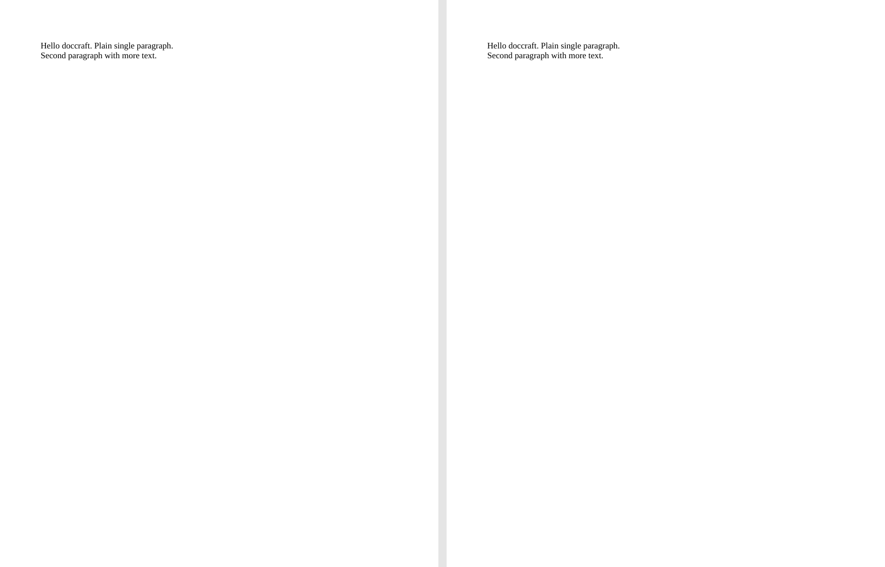
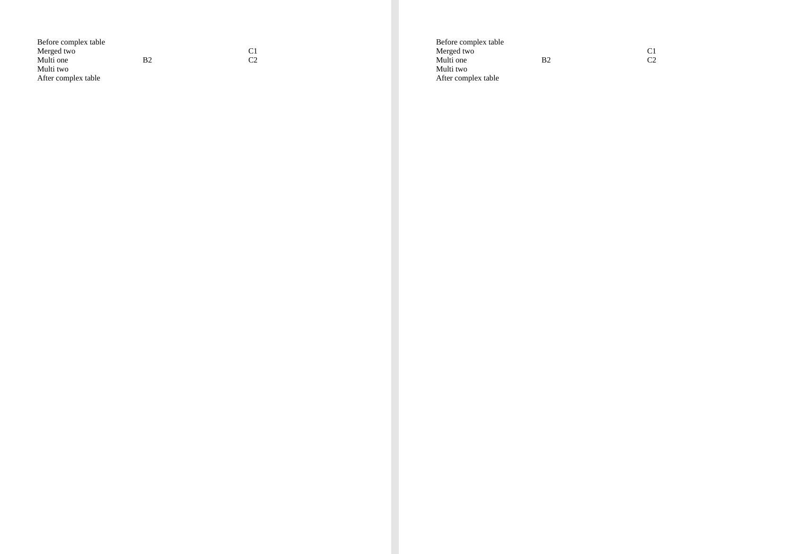
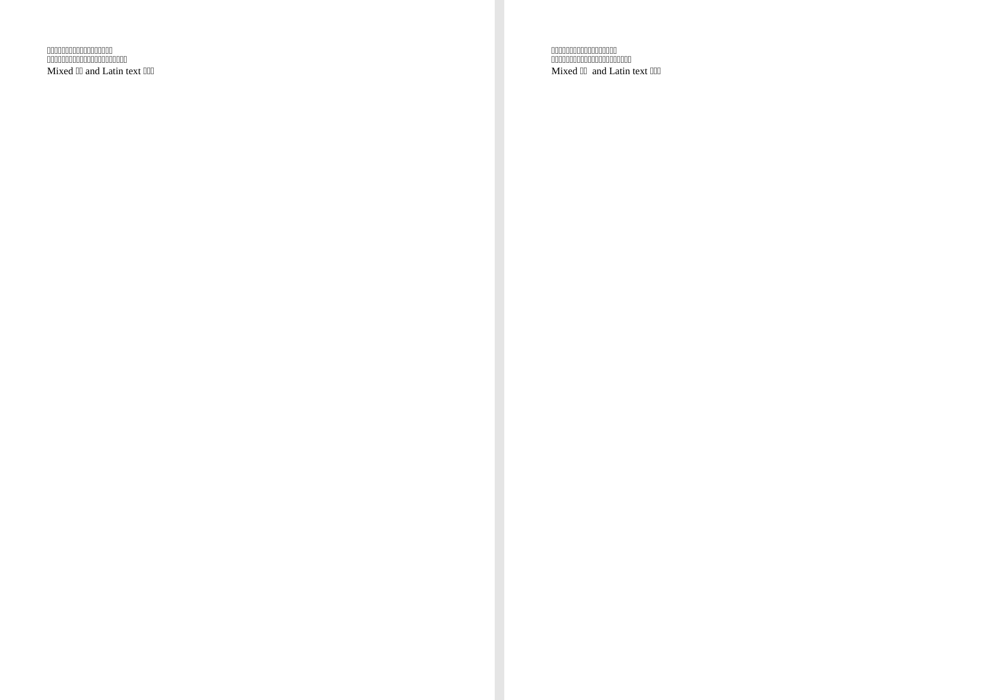
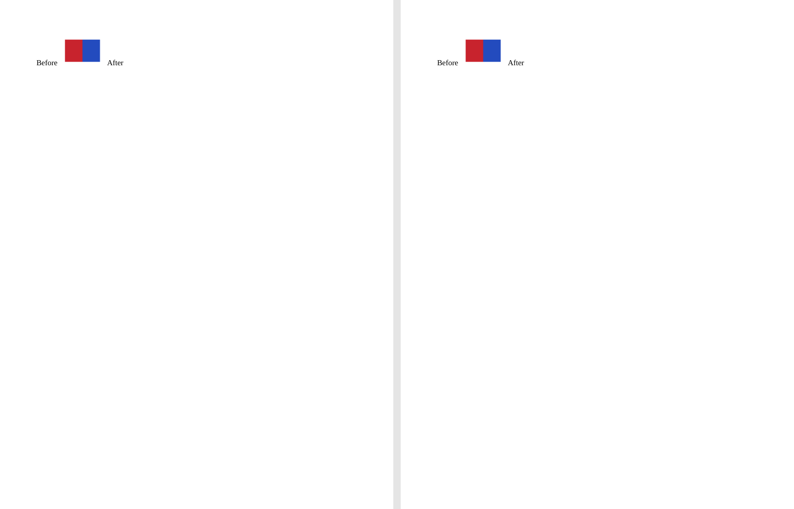
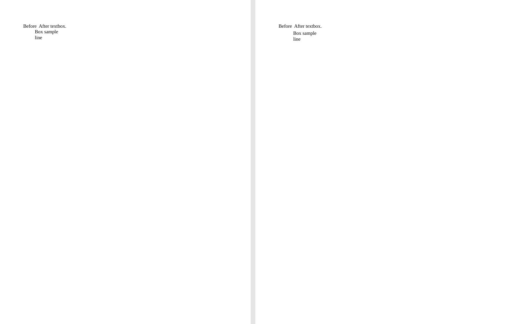
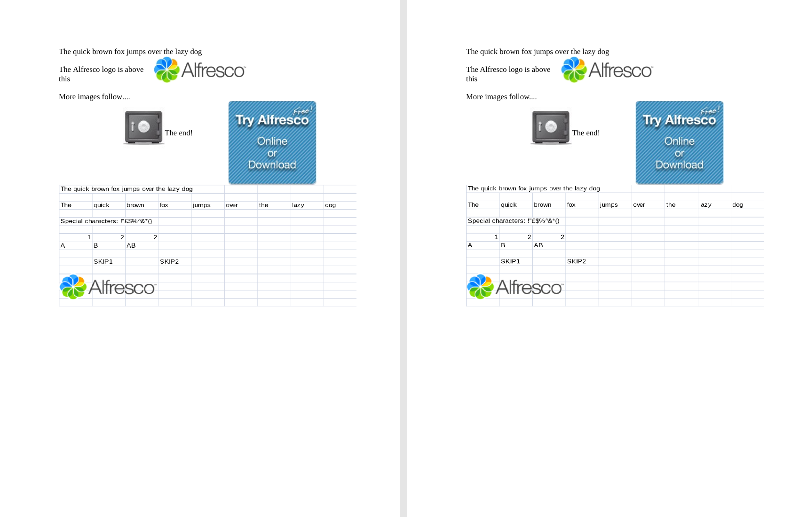
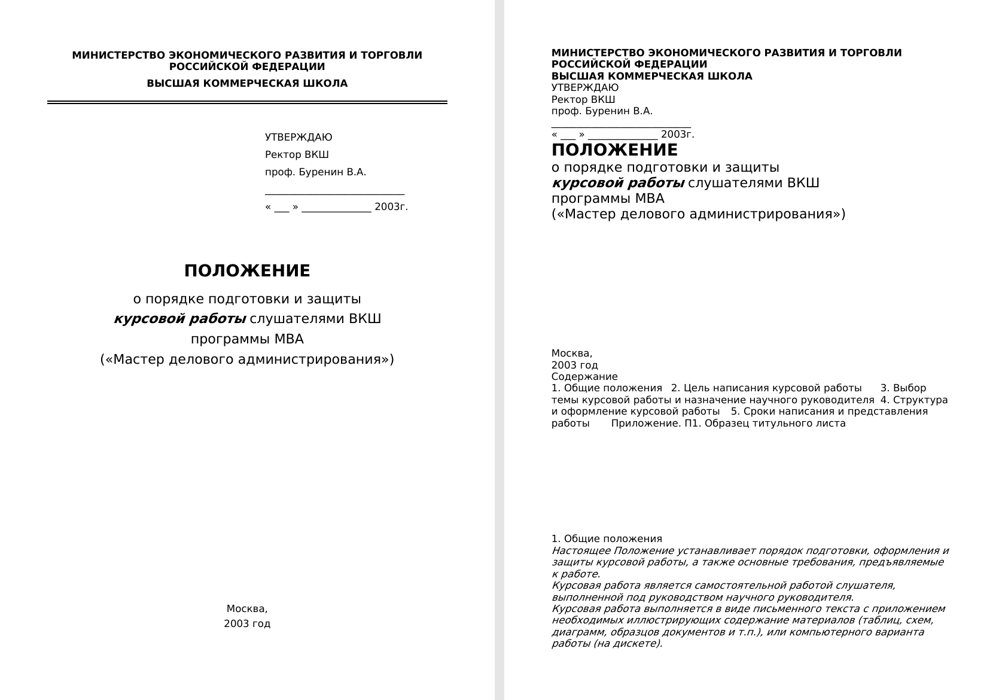

# doccraft

High-fidelity `.doc` → `.docx` conversion in C++23, packaged as a single binary
with no third-party runtime dependencies.

doccraft reads Word 97–2003 binary documents and writes ECMA-376 Transitional
DOCX. It runs locally without an Office installation. The converter is at
**v0.9.0-rc1 preparation**: the main feature paths are implemented, while M6
hardening remains open.

## Quick start

Requires CMake 3.20+, a C++23 compiler, and network access for the first
configure to fetch GoogleTest. The conversion binary itself has no runtime
Office or third-party library requirement.

```bash
cmake -B build -DCMAKE_BUILD_TYPE=Release
cmake --build build -j
ctest --test-dir build --output-on-failure

build/src/cli/doccraft convert input.doc -o output.docx
build/src/cli/doccraft convert protected.doc --password secret -o output.docx
build/src/cli/doccraft inspect input.doc
```

## What it handles

- Text and formatting: ANSI and UTF-16 pieces; character, paragraph, and
  section properties; styles, numbering, headers, footers, and multiple
  sections.
- Structure: tables, hyperlinks and general fields, bookmarks, comments,
  footnotes, and endnotes.
- Embedded content: inline and floating images, main-story floating text
  boxes, and OLE ObjectPool payloads with field-result previews.
- Languages: Unicode text, RTL and complex-script formatting, and document
  language ID to ANSI code-page mapping. The implementation lists 15 code-page
  decoders; non-CP1252 decoding requires iconv at build time.
- Recovery: final piece-table reconstruction for fast-saved documents,
  legacy RC4 and RC4 CryptoAPI decryption with a password, and warnings for
  selected recoverable formatting or header damage.

Feature states and their boundaries are in [the design checklist](docs/DESIGN.md)
and [known simplifications](docs/KNOWN-SIMPLIFICATIONS.md). The applicable sprm
ledger is tracked in [SPRM coverage](docs/SPRM-COVERAGE.md).

## Measured performance

The five committed measurements below come from
[`tests/perf/baseline.json`](tests/perf/baseline.json). The benchmark converts
generated structured DOC files five times per size; wall time is the median,
and peak RSS is the maximum of those runs. These are measurements from that
baseline, not cross-machine guarantees.

| Input DOC | Actual size | Median wall time | Peak RSS |
|---:|---:|---:|---:|
| 1 MiB tier | 1.00 MiB | 0.037 s | 16.6 MiB |
| 5 MiB tier | 5.00 MiB | 0.180 s | 68.3 MiB |
| 20 MiB tier | 20.00 MiB | 0.905 s | 261.8 MiB |
| 50 MiB tier | 50.24 MiB | 1.111 s | 322.2 MiB |
| 100 MiB tier | 99.99 MiB | 3.990 s | 1,287.9 MiB |

Reproduce with `tests/perf/gen_corpus.py` and `tests/perf/run_perf.py` after
building the converter. The 100 MiB result shows that memory use is not yet
bounded; streaming and an explicit memory cap are M6 work.

## Visual fidelity

The [pixel comparison pipeline](tests/pixelcompare/README.md) renders the same
source `.doc` through two LibreOffice paths: source DOC → PDF → PNG, and source
DOC → doccraft DOCX → PDF → PNG. It compares corresponding pages at 150 DPI,
rejecting a page with a size mismatch or at least 0.1% pixels differing by
more than 16 grayscale levels. Page-count exceptions require a sample-specific
`.allow` file.

At the current baseline, **28 of 33 committed DOC samples pass**, four fail,
and one cannot be rendered from the output DOCX by LibreOffice. See the
[per-sample record](docs/PIXEL-BASELINE.md) for the version, exceptions, and
failures. Pixel agreement in LibreOffice does not establish identical rendering
in Microsoft Word.

### Example gallery

Each image shows **source DOC on the left** and **doccraft DOCX on the right**,
both rendered by LibreOffice. These are unretouched first-page captures at
100 DPI; the [gallery generator](tools/gen_gallery.py) can regenerate or check
their bytes. The fast-saved and OLE examples demonstrate conversion, not a
pixel PASS claim.

| Plain text | Complex table |
|---|---|
|  |  |

| CJK text | Inline image |
|---|---|
|  |  |

| Floating text box | OLE object |
|---|---|
|  |  |

| Fast-saved document, first page |
|---|
|  |

Regenerate after building the CLI with `python3 tools/gen_gallery.py`; verify
the checked-in PNGs with `python3 tools/gen_gallery.py --check`. This needs
LibreOffice, Poppler's `pdftoppm`, and Pillow.

## Architecture

```text
CFB container (src/cfb) → DOC parser (src/doc) → neutral IR (src/model)
                                                  ↓
                                         DOCX writer (src/docx)
```

The four layers pass data in one direction. Shared byte and character decoding
primitives live in `src/base`; the DOC parser and DOCX writer meet only through
the format-neutral model. See [DESIGN](docs/DESIGN.md) for the full layout.

## Known limits

- RC4-encrypted documents are detected and rejected; password-based decryption
  is not implemented.
- Complex shapes and WordArt are not restored as editable artwork. Floating
  image wrap polygons and some text-box styling remain incomplete.
- LibreOffice lays out the endnote in `footnote-endnote.doc` on a separate page
  after conversion; the documented page-count exception preserves this gap.
- Fast-saved samples can preserve text while changing pagination; some OLE
  objects lack a preview when the source has no field-result image.

The detailed list is in [KNOWN-SIMPLIFICATIONS](docs/KNOWN-SIMPLIFICATIONS.md).

## License and specifications

Licensed under [Apache-2.0](LICENSE). The parser follows
[[MS-CFB]](https://learn.microsoft.com/en-us/openspecs/windows_protocols/ms-cfb/)
and [[MS-DOC]](https://learn.microsoft.com/en-us/openspecs/office_file_formats/ms-doc/);
the writer targets [ECMA-376](https://ecma-international.org/publications-and-standards/standards/ecma-376/)
Transitional OOXML.
